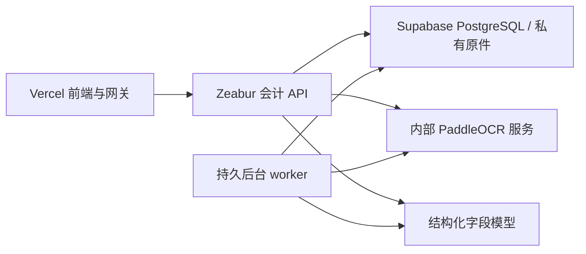

# 第十九阶段：独立 OCR 与字段证据

本阶段在现有会计流水线上增加 PaddleOCR 内部服务。原有 `vision` 模式继续可用；管理员显式选择 `paddleocr` 后，员工预填与事项票据识别使用独立文字证据，再交给已有 OpenAI 兼容接口提取字段。PaddleOCR 不接触账务数据库，也不拥有审批、凭证修改或导出能力。

已执行的回归、真实模型运行记录及未验收边界见 [阶段验收记录](STAGE19_VALIDATION.md)。

## 复用范围与运行位置

`services/paddle_ocr` 通过固定版本官方 SDK 复用 PP-OCRv6 检测、识别与推理流水线，适配代码、官方来源和许可证保存在 `third_party/PaddleOCR`。没有将旧版训练、演示前端和无关模型全部复制进业务后端。升级依赖或模型时必须更新服务指纹并重新评测。

初版使用 CPU 的 `PP-OCRv6_small_det` 和 `PP-OCRv6_small_rec`。已保留后端 EXIF 方向处理；服务的整页方向、文本行方向和非线性曲面纠偏固定关闭，因此文字框始终对应输入页像素，不能声称已经支持歪曲票据自动修复。复杂表格 PP-StructureV3 与 PaddleOCR-VL 仍是后续按样本评测接入的增强项，本次没有默认加载。

部署关系：



API 的 OCR 调用用于员工预填；批量业务识别仍由现有持久队列执行。内部 OCR 只接收内联图片，拒绝外部图片 URL；服务不配置 Supabase 凭据。它使用独立访问令牌、单进程有界推理，并在繁忙时拒绝新请求，由业务任务队列负责调度与重试。

## 部署与配置

1. 创建独立 OCR 容器服务。Zeabur 的 Root Directory 选择 `services/paddle_ocr`，使用该目录 Dockerfile；本机构建使用 `docker build -t hengzhang-paddle-ocr:3.7.0 services/paddle_ocr`。具体启动、令牌和模型目录配置见该目录 README。Vercel 不运行 Paddle 推理。
2. 先等待模型准备和健康检查通过，再切换业务服务。模型准备需要下载权重，不应把冷启动时间误计为稳定单页耗时。若运行在 Windows，本地模型缓存应使用不含中文字符的路径；Docker 使用容器中的 ASCII 路径。
3. 在会计 API、OCR worker、助手 worker 设置相同的识别参数。保持已有 LLM 接口配置；Paddle 只输出文字，不能单独替代字段提取模型。

```dotenv
ACCOUNTING_OCR_ENGINE=paddleocr
ACCOUNTING_PADDLEOCR_URL=https://YOUR_PRIVATE_OCR_ORIGIN
ACCOUNTING_PADDLEOCR_TOKEN=REPLACE_WITH_SERVICE_TOKEN
ACCOUNTING_PADDLEOCR_MODEL=PP-OCRv6_small_det+PP-OCRv6_small_rec@px3.7.2-pd3.3.1-det2048-line0-doc0-unwarp0-r1
ACCOUNTING_PADDLEOCR_MIN_SCORE=0.85
ACCOUNTING_PADDLEOCR_ALLOW_HTTP=0
ACCOUNTING_PADDLEOCR_ALLOWED_HOST=
```

`URL` 为源站，不包含 `/v1/recognize`、用户名、密码或查询参数。生产优先使用 HTTPS；如容器私有网络使用 HTTP，必须显式设置 `ALLOW_HTTP=1` 并将 `ALLOWED_HOST` 设置为 URL 中完全相同的主机名。禁止把此服务令牌放进 `VITE_` 变量或浏览器请求。

使用 Zeabur 管理 API 时，须读回并确认服务本身的 `rootDirectory=services/paddle_ocr`，不能只依赖部署 specification 中的同名字段；错误的仓库根上下文会让 `COPY requirements.lock` 失败。将 Watch Paths 单独设为 `/services/paddle_ocr`，避免业务后端或文档变更重建推理镜像。Root Directory 与 Watch Paths 是两个配置项，见 [Zeabur 监控路径说明](https://zeabur.com/docs/en-US/deploy/config/watch-paths)。

`ACCOUNTING_AI_OCR_*` 继续配置结构化字段模型。Paddle 模式下该模型基于文字提取字段，原有模型费用预留和企业额度限制继续生效。访问令牌轮换不改变识别语义；OCR 模型、阈值、预处理或字段提示版本改变会使旧缓存与待执行任务配置失效，需按新配置重新处理。

回退方式是将所有业务进程的 `ACCOUNTING_OCR_ENGINE` 一致改回 `vision` 后重启，保留历史独立识别证据。系统不会在 Paddle 失败后悄悄改用另一条视觉接口发送附件。

## 处理与证据边界

- 已支持票种的数电票 XML 继续本地确定性解析，不经过 Paddle 或字段模型；其他票种沿用原人工处理边界。
- PDF 页有可用原生文字时可利用文字；照片、扫描页调用独立 OCR。原 PDF 文字核验继续保留，不因加入另一份 OCR 文本而消失。
- Paddle 输入来自授权原件的有界解码，最长边 4000 像素；PDF 仍限制完整 1–6 页，在独立进程中渲染。不会静默截断超限页面。
- 多页扫描件按服务像素容量顺序分批，但仍属于同一个持久任务；每批发送前及字段模型调用前重新检查授权。识别失败交回现有重试或人工处理流程，不输出残缺文档冒充完整识别。
- 各批共享 OCR 阶段截止时间，不能各自重新获得一份完整超时；从读取原件前设置 150 秒处理预算，并为字段模型及结果校验预留时间。预算不足时停止发送，避免超过预填记录既有的 3 分钟过期窗口。
- 模型输出继续使用原字段 schema，不能自行提供独立文字框。后端将字段引用绑定 OCR 块，保留页码、识别分数、模型和预处理版本。关键字段未匹配或识别分数低时形成阻断问题，不能把分数当作会计正确率。
- 字段定位通过当前授权下的私有页面接口获取图片，核对原件摘要、页面大小和证据版本；图片不写入公开目录。企业切换、撤权或退出时前端取消请求并清理对象 URL。
- 定位预览保持原识别页面宽高，仅按需调整 JPEG 编码质量至不超过 3 MiB，以适配 Vercel 网关。它不改变上传原件、OCR 输入或文字框坐标；仍超限时明确提示人工查看原件。
- 定位展示位于保存事项后的票据核对页。员工尚未保存的预填页继续展示候选字段；低分、缺证等问题字段不能直接作为预填候选。保存后完整证据随识别记录转入事项，不丢失来源。
- 业务事项金额、税额加总、交易对方、税号、日期、重复来源及流水核对继续运行。识别成功不代表核票完成，凭证仍须会计复核后导出。

独立识别证据随既有识别记录保存，复用仍限定事务所与企业范围。本阶段未引入新的数据库表；部署前应先完成此前版本要求的 PostgreSQL 082，并同步发布 API、全部相关 worker 和前端。

## 用量与费用

运行记录区分独立 OCR 页数、原生文字页数、识别耗时与模型 token。自托管资源成本标记为尚未定价，不能解释为免费；原有 token 费用只是后续字段模型的费用口径。CPU/GPU 账单、空闲模型内存、失败重试资源开销需要部署方结合实际实例单价核算。

开始 OCR 前仍先检查企业额度；如果独立 OCR 失败或授权撤销，且尚未发送字段模型请求，释放本次 LLM 费用预留。已经发送模型请求的失败保留真实 token 或待确认费用，不因 OCR 自托管而将后续模型调用记为免费。

## 固定票据对照评测

现有产品内固定样本集和独立确认标准仍是版本评测入口。另提供只读离线工具 `scripts/evaluate_ocr_fields.py`，用于对已授权导出的样本结果统计字段准确率、未告警错误、人工修正时间、P95 耗时和已知费用，不调用模型，不写入生产数据，不生成发布或自动审核授权。

每行对应已明确配对的单张票据；同附件多张票据必须拆分为独立样本。标签与结果分开保存，标签不能进入模型输入。真实文件保存在被 Git 忽略的本地目录，不放入源码。

标签 JSONL 示例（虚构）：

```json
{"sample_id":"synthetic-001","category":"photo","fields":{"invoice_number":"00010001","gross_amount":"106.00","tax_amount":"6.00","seller_tax_id":"SYNTHETIC-TAX-ID"}}
```

结果 JSONL 示例（虚构）：

```json
{"sample_id":"synthetic-001","status":"succeeded","review_required":false,"fields":{"invoice_number":"00010001","gross_amount":"106.00","tax_amount":"6.00","seller_tax_id":"SYNTHETIC-TAX-ID"},"duration_ms":1500,"correction_seconds":0,"cost_cny":null}
```

```powershell
python scripts/evaluate_ocr_fields.py --labels .codex/labels.jsonl --results .codex/baseline.jsonl --results .codex/paddle.jsonl --output .codex/ocr-comparison.json
```

报告候选顺序与 `--results` 顺序一致。缺失结果计入分母；缺失字段不等于明确的 `null`；未知税额不等于零；未知费用不等于免费；已有报告不会被覆盖。`review_required` 表示识别管道是否明确要求处理，不是会计审核状态。离线工具不验证标签人的授权或独立性，因此不能替代产品内标准确认流程。

试点应分别统计清晰电子票、手机照片、扫描件、热敏收据和复杂版面，至少同时关注总额/税额/票号/税号、错误未被提示的比例、人工核对时间与成本。合成票据跑通只证明 SDK 与接口可工作，不能证明真实企业票据准确率提高。
